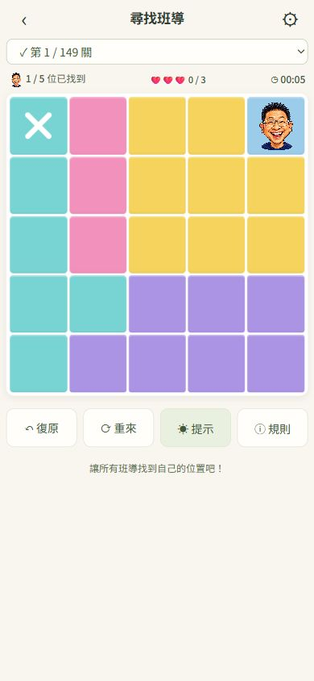
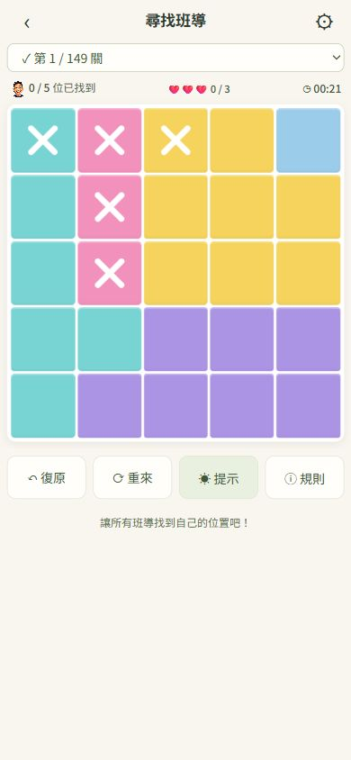
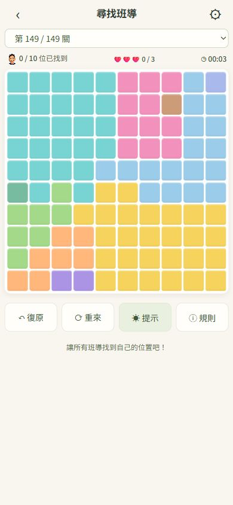

# 尋找班導｜互動改善 V2

2026-10-15。本機 `feature/mobile-ui` 候選版，未推送、未合併、未部署正式站。

## 本次六項修改

1. **點擊效能**：格子與選關選項改為保留 DOM 節點，只更新變動格子的內容、狀態與標籤。滑動時不反覆寫入 localStorage，整段結束後才儲存。
2. **背景原色**：原色在建格時設定一次；關閉 hover/active/focus 的亮度與背景變化，移除原生按鈕外觀，透明班導頭像不覆蓋色區。
3. **智慧滑動**：一般滑動只新增 ×，既有 ×、班導與紅色錯誤 × 保留。2.5 秒內再滑過幾乎相同的路徑（至少兩格、重疊至少八成，且原本全部為 ×）時，在放開後清除。也可在 × 上停留至少 450ms 再滑動，直接進入清除模式。單點 × 仍立即清除。
4. **圓角 ×**：以兩條圓頭線段取代字型符號，手機與桌面顯示一致；一般為白色，錯誤為紅色。
5. **單格色區**：產題不再限制單格色區數量，仍要求區域存在、連通、規則成立與唯一解。
6. **10×10**：補上第十種顏色，新增第 149 關 10×10 範例，包含多個獨立單格區域；原本第 1–148 關內容與索引完整保留。

交叉滑動與清除使用可重現的手勢規則，不是 AI 猜測玩家意圖。只碰到一格的交叉、間隔過久、或路徑有新空白格，都不會被當成重劃清除。

## 瀏覽器效能對照

同一台電腦、同一個 Chromium 瀏覽器、同一張 9×9 關卡，各連續操作 20 個不同格子。修改前基準來自 `8599b00`，只加入同樣的渲染計時與重建次數紀錄。

| 指標 | 修改前 | 修改後 |
|---|---:|---:|
| render 處理時間中位數 | 7.4ms | 0.4ms |
| render 處理時間最大值 | 22.7ms | 0.7ms |
| 棋盤重建次數 | 20 | 0 |
| 選關列表重建次數 | 20 | 0 |

數據為同步 render 處理時間，包含該函式內的 DOM 更新與存檔，不是整體輸入到畫面顯示的端到端延遲。不同裝置數字會不同。原始紀錄見 `performance.json`。

`verify-interactions.cjs` 另檢查同題 100 次點擊沒有新增 DOM 節點、沒有重建棋盤/選單，且一次滑動只存檔一次。

## 底色與標記實測

390×844 手機視窗，找到第 1 關第 1 行第 5 列的班導前後：

- 背景均為 `rgb(155, 204, 233)`。
- filter 均為 `none`。
- 頭像背景為 `rgba(0, 0, 0, 0)`。
- 圓頭線段寬約 43.6px、高約 6.3px，端點採膠囊圓角。

原始紀錄：`color-and-mark.json`。



實際滑鼠拖曳先標橫線，再用直線交叉：交點的原有 × 保留，直線新增位置正常標記。



## 版面矩陣

| 視窗 | 棋盤 | 結果 |
|---|---|---|
| 360×800 | 5×5、6×6、7×7、8×8、9×9、10×10 | 六組通過 |
| 390×844 | 同上 | 六組通過 |
| 412×915 | 同上 | 六組通過 |
| 1920×1080 | 10×10 | 通過 |
| 3840×2160 | 10×10 | 通過 DOM 尺寸檢查 |

共 20 組，格子寬高差低於 0.02px，所有色區均有背景色，棋盤完整顯示且沒有水平溢出。原始數據：`layout-results.json`。

4K 截圖工具未成功回傳圖片，因此不提供未取得的 4K 截圖；其實際 DOM 尺寸檢查為 1680×1680px，100 格寬高相等。



## 自動化回歸

以下指令全部通過：

```text
node verify-interactions.cjs
node verify.cjs
node verify-mobile.cjs
git diff --check
```

涵蓋交叉保留、重劃清除、長按清除、過期路徑不清除、取消手勢、一次復原整段、點選反應、149 關唯一解、所有關卡過關、失敗三次、舊存檔相容、五秒慶祝、自動晉級、手機導覽、提示與 5×5～10×10 觸控指標事件。

原本 148 關的內容雜湊維持不變；第 149 關為附加資料，不會位移舊存檔的關卡索引。`add-ten.cjs` 再次執行不會重複新增。

## 限制與待確認

- 瀏覽器實測使用滑鼠點擊、雙擊、拖曳與指定手機視窗；觸控長按與重劃時序另以 `pointerType: touch` 事件測試。
- Android/iPhone 真機的長按手感、系統觸控延遲與 Safari 差異尚待確認。
- 仍保留單點與長按清除兩種明確操作，避免只依賴重劃推斷。
- 候選版仍需使用者確認後才合併與發佈。
