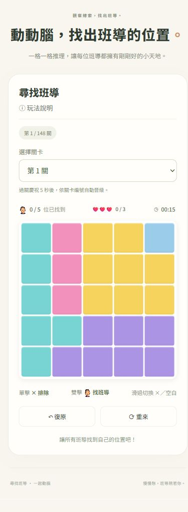
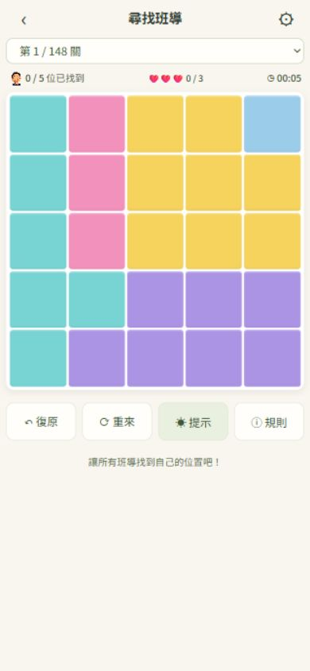

# 尋找班導｜Mobile UI V1.0 驗收紀錄

日期：2026-10-15。狀態：本機 `feature/mobile-ui` 候選版，等待使用者確認；未推送、未合併 main、未部署正式站。

## 專案與修改範圍

- 本機原本為無提交、無 remote 的 Git 儲存庫。已建立 `feature/mobile-ui`，以 `b826186` 保存修改前版本。
- 已讀取公開 GitHub 儲存庫頁面，確認同樣使用根目錄入口、`dist`、README 與產題/驗證腳本的結構；未將本機歷史當成遠端 main 歷史。
- 正式路徑仍為 `/teacher-sudoku/dist/index.html`。本機瀏覽器測試使用獨立的 `127.0.0.1:4173` 預覽來源，不會讀寫使用者正式站或 file 頁面的進度。
- `dist/index.html`：加入首頁開始按鈕、精簡 App Bar、設定對話框、規則工具按鈕與安全區域 viewport。
- `dist/mobile.css`：新增獨立手機樣式；1099px 以下生效，桌面既有樣式檔未修改。
- `dist/mobile-ui.js`：首頁/遊戲切換、返回、設定、減少動畫偏好；不呼叫重來或清空存檔。
- `dist/app.js`：恢復提示按鈕、關卡選單顯示當前/總關卡、手機首頁暫停計時。原單擊、雙擊、滑動、復原與失敗邏輯保留。
- 未新增 PWA、Service Worker 或套件依賴。

## 手機版面實測

使用 Chromium 瀏覽器實際版面、DOM 尺寸與截圖檢查，五種棋盤各測三個尺寸，共 15 組。

| 視窗 | 棋盤尺寸 | 棋盤寬高約 | 棋盤距頂約 | 結果 |
|---|---|---|---|---|
| 360×800 | 5×5、6×6、7×7、8×8、9×9 | 344×344px | 116px | 全部通過 |
| 390×844 | 5×5、6×6、7×7、8×8、9×9 | 374×374px | 116px | 全部通過 |
| 412×915 | 5×5、6×6、7×7、8×8、9×9 | 396×396px | 116px | 全部通過 |

逐格寬高差低於 0.02px（瀏覽器次像素取整），所有格子位於棋盤內，無水平溢出。工具列四個按鈕皆可使用，觸控高度 48px。

另測 360×480：頁面高度 569px，允許正常垂直捲動，棋盤與底部工具列沒有被裁切或固定高度容器遮住。

原始數據：`layout-matrix.json`。

## 功能與手勢

實際瀏覽器測試：

- 單擊標記 ×、再次點擊取消。
- 雙擊正確位置顯示班導頭像。
- 拖曳連續標記、再次拖曳清除、一次復原整段拖曳。
- 提示、重來、規則、設定、減少動畫偏好。
- 返回首頁再開始不重設進度；重新載入後保留已找到數量。
- 第三次犯錯顯示失敗對話框，重試回到同一關。
- 完成第 1 關顯示慶祝，五秒後自動進入第 2 關。
- 檢查瀏覽器主控台，沒有警告或錯誤。

`node verify-mobile.cjs` 另外使用 `pointerType: 'touch'` 事件測試 5×5～9×9 的往返滑動、每格每手勢只切換一次、保留班導、整段復原；也驗證首頁暫停計時與導覽不改寫遊戲進度。

`node verify.cjs` 全部通過，涵蓋 148 關唯一解、遊戲操作、犯錯、舊進度相容、慶祝、晉級與圖像。提示功能依本次要求恢復。

## 桌面回歸

| 視窗 | 棋盤約 | 結果 |
|---|---|---|
| 1920×1080 | 886×886px | 左側資訊、中央棋盤、右側規則維持三欄 |
| 3840×2160 | 1680×1680px | 三欄、格子正方形、無水平溢出 |

手機 App Bar 與首頁在桌面皆隱藏。原始數據：`desktop-results.json`。

## 資料與路徑

`dist/levels.js` 完全未修改；SHA-256：

`e930e1f2e87ac42b8660f4fbc24177e5c74080dae19e69d5098d995ccab7018d`

存檔 key 與原有資料欄位維持不變；新增的首頁狀態使用 sessionStorage，減少動畫偏好使用獨立 key。所有 CSS、JS、圖像以相對路徑載入。

## 截圖

| 修改前 | 修改後（相同 5×5） |
|---|---|
|  |  |

新增首頁：

其他截圖包含三種指定尺寸的遊戲頁、9×9、桌面 1080p/4K、失敗與成功畫面。

## 驗證限制與待確認

- 以上是實際瀏覽器視窗測試及觸控指標事件模擬，尚未在 Android/iPhone 實機上操作。
- 已使用 `viewport-fit=cover` 與四向 `safe-area-inset-*`，並讓工具列處於正常可捲動文件流；實體瀏海、系統手勢列與軟鍵盤仍須真機確認。
- 未測 Safari/WebKit 引擎；瀏覽器模擬不能取代 iOS 雙擊與觸控的真機驗證。
- 候選版未部署，正式站維持原樣。確認後才進行合併/發佈。
